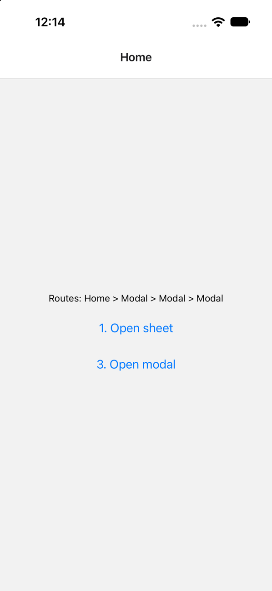

# TrueSheet: modals stop opening after navigating while a sheet dismisses

Minimal reproducer for an iOS bug in
[`@lodev09/react-native-true-sheet`](https://github.com/lodev09/react-native-true-sheet)
when it is used with the `react-native-screens` patch from its
[navigation guide](https://sheet.lodev09.com/guides/navigation#navigating-from-sheets).

Dismissing a sheet and navigating to a modal screen in the same handler leaves
the native stack unable to present modals. React Navigation's state keeps
advancing, but nothing is shown until the app restarts.



## Versions

- `react-native` 0.88.1, new architecture, iOS 27.0 simulator
- `@lodev09/react-native-true-sheet` 4.1.0
- `react-native-screens` 4.30.1, patched by `patch-package` with
  [the patch from the TrueSheet repo](https://github.com/lodev09/react-native-true-sheet/blob/main/.yarn/patches/react-native-screens-npm-4.30.0.patch)
  (`patches/`)
- `@react-navigation/native-stack` 7.21.0

## Run

```sh
npm install
cd ios && bundle install && bundle exec pod install && cd ..
npm run ios
```

## Steps

1. Tap **1. Open sheet**.
2. Tap **2. Close sheet and open modal**. It calls `sheet.dismiss()` and then
   `navigation.navigate('Modal')`.
3. Tap **3. Open modal** a few times.

Expected: the modal opens after step 2, and again on each tap in step 3.

Actual: the sheet closes and no modal ever opens. "Routes" shows
`Home > Modal` after step 2 and gains a `Modal` per tap in step 3.

Without the patch (delete `patches/`, reinstall and rebuild) the modal opens.

All of the code is in [App.tsx](App.tsx). Recordings:
[before](media/before.gif), [after the fix](media/after.gif).
